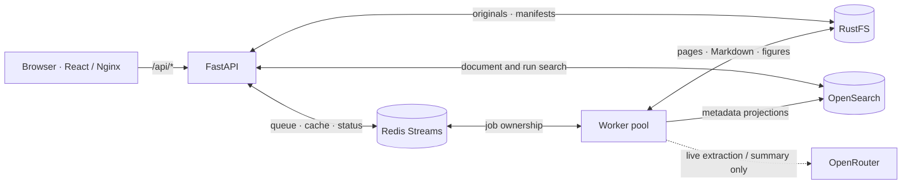

# PDF Processor

**Self-hosted PDF → Markdown processing, AI OCR, figure extraction, and persistent document search.**

**Version 0.12.3 · MIT License · Docker Compose · Linux**

PDF Processor provides a React interface for PDF and ZIP uploads, asynchronous extraction, AI-generated summaries, searchable History and Document Library, and downloadable results. The **AI OCR + Pictures** parser extracts page text and figures in one vision request per page, creates PNG crops from the source PDF, displays them alongside Markdown, and exports portable bundles.

> **Deployment boundary:** Designed for a trusted, single-user Linux host with loopback-only exposed ports. There is **no built-in login, per-user authorization, or TLS gateway**. Do not expose the application directly to the public internet.
>
> **CI is free of paid AI calls.** No OpenRouter key is needed to build or run the offline tests. Actual processing requires an OpenRouter key for summaries; AI-based extraction modes also require that key and may incur charges.

## Features

| Capability | Current behavior |
|---|---|
| Extraction | Local PyPDF (`pypdf`), native-PDF AI (`gemini`), image OCR (`gpt5_mini`), AI OCR + Pictures (`vision_figures`) |
| Ingest | Up to five PDF files per request, or one ZIP containing up to 20 PDFs; configurable size/page limits |
| Processing | Redis Streams queue, two worker containers by default, status polling, deduplication and caching |
| Outputs | Ordered Markdown pages, AI summary, partial-result recovery, per-run metadata and trace IDs |
| Figures | PDFium image crops, figure manifest, safe same-origin PNG preview and Markdown/images ZIP |
| Persistence | Original PDFs and immutable run artifacts in RustFS (S3-compatible storage) |
| Discovery | History, Document Library, run/document detail, OpenSearch-backed filtering and pagination |
| Operations | System Monitor, structured diagnostics, archive reconciliation, index rebuild, backup/restore |
| Quality and security checks | Offline integration tests with real Redis/RustFS/OpenSearch, CodeQL, Dependabot |

The four parser identifiers are compatibility IDs, **not hard-coded model names**. Models can be configured in `.env`.

## Architecture



**RustFS is the durable source of truth.** Redis is ephemeral coordination/cache; OpenSearch is a rebuildable index. See [system architecture, data model, and processing diagrams](docs/ARCHITECTURE.md).

## Quick start (Linux)

Requirements: Docker Engine with Compose v2, Bash, internet for first build, sufficient memory/disk for the services, and host `vm.max_map_count >= 262144` for OpenSearch. Docker images provide Python 3.15.2 and Node 22; no host installation is needed.

```bash
# In a clone of this repository:
cp .env.example .env
chmod 600 .env
# Edit .env: change S3_SECRET_KEY and optionally set OPENROUTER_API_KEY.
./scripts/setup.sh --no-prompt
```

Open **http://localhost:3000**. API: **http://localhost:8000**; RustFS local console: **http://localhost:9001**. Docker binds these ports to `127.0.0.1`.

The application and monitoring can start without an API key, but ordinary PDF jobs cannot complete the AI summary stage without one. For a fully free demo, use the offline test fixtures instead of live processing.

**Storage warning:** Routine restarts preserve Docker volumes. `docker compose down -v` **deletes the RustFS/OpenSearch named volumes and archived PDFs**. Back up the archive before destructive maintenance. Use `docker compose down` *without* `-v` to stop normally.

See [installation and troubleshooting](QUICKSTART_LINUX.md) and [operations and backup/restore](docs/OPERATIONS.md).

## Test locally without an OpenRouter key

```bash
# Docker + real Redis / RustFS / OpenSearch, with mocked AI responses:
./scripts/test_release.sh --offline
./scripts/check_figures.sh --offline
./scripts/check_regressions.sh

# Optional: frontend-only (Node 22 and npm):
cd frontend && npm ci && npm test && npm run build
```

**Important:** `scripts/test_release.sh` **without `--offline` invokes paid test modes**. GitHub Actions always use `--offline`, explicitly blank the provider key, and require no repository secrets. See [CI and testing](docs/CI_AND_TESTING.md).

## AI OCR + Pictures: limitations

The `vision_figures` parser renders each page with PDFium, requests full-page Markdown plus figure boundaries, validates the response, and crops image pixels from the original PDF. It stores image bytes and a manifest in the durable run archive. Cached/shared runs retain independently addressable figure assets. Users can preview images in the UI and download `document.md`, `figures.json`, and `images/` in a ZIP.

This is **best-effort extraction**. Bounding boxes and caption placement can be inaccurate; printed captions may appear in crops, or a figure may be partially clipped. Dense scans can produce incomplete text. Review results for fidelity-sensitive documents. No live-model evaluation or perfect-cropping claim is made by offline CI.

## Documentation

| Document | Purpose |
|---|---|
| [Project overview](project_overview.md) | Detailed **current** implementation, scope, and limitations |
| [Architecture](docs/ARCHITECTURE.md) | Services, data ownership, processing and figure-flow diagrams |
| [Linux setup](QUICKSTART_LINUX.md) | Installation, safe upgrade, and troubleshooting |
| [Configuration](docs/CONFIGURATION.md) | Environment variables and resource/AI limits |
| [API](docs/PERSISTENT_API.md) | Upload, runs, library, images, downloads, and consistency contracts |
| [Operations](docs/OPERATIONS.md) | Backup/restore, recovery, search rebuild, deletion, monitoring |
| [Offline testing and CI](docs/CI_AND_TESTING.md) | GitHub workflows, free test coverage, what is not tested |
| [Roadmap](docs/ROADMAP.md) | Potential future improvements (not promises) |
| [Security](SECURITY.md) | Deployment boundary and vulnerability reporting |
| [Contributing](CONTRIBUTING.md) | Development, test, and PR guidelines |

## License and contributing

Licensed under the [MIT License](LICENSE). Issues and pull requests are welcome; please read [CONTRIBUTING.md](CONTRIBUTING.md). Before publishing, follow the [GitHub checklist](docs/PUBLISHING_GITHUB.md) and verify that all bundled third-party materials and synthetic PDF fixtures are redistributable.
