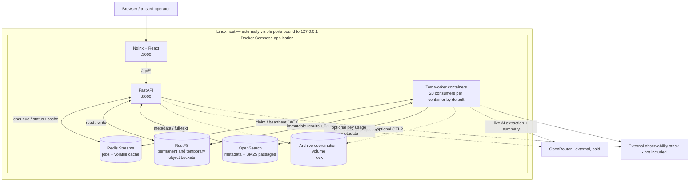
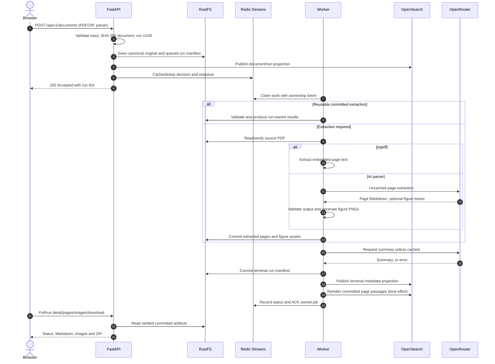
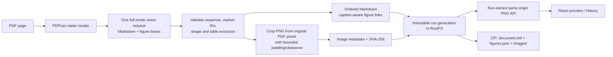
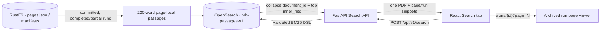

# Architecture — PDF Processor 0.12.7

This document describes the **currently implemented** system. Diagrams use native GitHub Mermaid Markdown. It is a single-host, trusted-user Docker Compose architecture; it is not a public multi-tenant service.

## Runtime services and trust boundaries

`frontend` exposes 127.0.0.1:3000 and proxies `/api/*`. `api` exposes 127.0.0.1:8000. RustFS exposes 127.0.0.1:9000/9001. Redis has no host port. OpenSearch runs on an internal Compose network without a published port; its security plugin is disabled. API/workers run as UID 10001, with dropped capabilities and no privilege escalation. A one-shot constrained initializer prepares named volume ownership.

The app currently uses Redis 7.4, RustFS 1.0.3, OpenSearch 3.10.0, Python 3.15.2 (backend), and Node 22/React 19 (frontend). Container and environment versions are defined by `docker-compose.yml` and the Dockerfiles.

## Upload, processing, and result lifecycle

Worker ownership, heartbeat, fenced manifest commits, and per-page model-call admission/checkpoint mechanisms limit duplicate work and help recovery. They do **not** guarantee exactly-once provider billing if a remote response is lost. A failed summary can leave a `partial` run with extracted text accessible and eligible for an explicit summary-only retry; extraction failure is recorded separately. Polling errors are not treated as empty history.

## Dedicated image / figure extraction flow

Model-generated page geometry is approximate, not authoritative: figures may be clipped, captions can be duplicated into pixel crops, and OCR on dense scans can be incomplete. Tables are intended to remain text/Markdown rather than be treated as picture assets. These limitations are documented in [the roadmap](ROADMAP.md) and covered only partially by offline fixtures.

## Object, index, and coordination ownership

| Data | Owner | Expected behavior |
|---|---|---|
| Original PDF | RustFS permanent archive | Identified by SHA-256 of source bytes |
| Document metadata | RustFS | Revisions, display names, preferred run, deletion tombstones |
| Run metadata | RustFS | Each submission has its own UUID, status, parser, artifact references |
| Page Markdown / summary | RustFS immutable run generation | Can be retained for partial runs and explicit summary retry |
| Figure manifest / PNG | RustFS run-owned artifacts | Hash-verified same-origin access and ZIP export |
| Search projections | OpenSearch | Derived document/run lists; rebuildable from archive |
| Pending jobs / cache / telemetry | Redis | Volatile; no source PDF durability guarantee |
| Archive maintenance coordination | Local named volume | Shared `flock`, single host, cooperative services only |

OpenSearch indexed lists may temporarily lag an authoritative RustFS read. Maintenance can reconcile durable state and rebuild indexes. Backups must include RustFS archive contents; preserving only the OpenSearch volume is insufficient.

## Failure boundaries

- **Redis restart:** in-memory cache, queues, and monitoring state can be lost. The durable archive and recovery/reconciliation mechanisms are separate; not every in-flight call can be replayed without risk.
- **Worker crash:** another worker can claim abandoned messages and reuse durable checkpoints, subject to ownership/fencing and paid-call ambiguity.
- **OpenSearch outage:** discovery is unavailable or degraded; direct authorized run/document reads can still use RustFS. No silent empty-result fallback.
- **RustFS outage / loss:** authoritative documents and result assets are unavailable; volume removal is data loss unless restored from backup.
- **OpenRouter error / timeout:** a run can fail or remain partial, with bounded diagnostics. The test suite cannot certify live model accuracy, provider availability, or exact billed cost.
- **Container recreation:** expected to preserve named volumes, but may interrupt jobs. `docker compose down -v` removes all named volumes and must not be used for routine maintenance.

See [API contract](PERSISTENT_API.md), [operations](OPERATIONS.md), [configuration](CONFIGURATION.md), and [security](../SECURITY.md).

## Full-text search pipeline

The passage index is a derived, resettable read model. Document SHA-256 groups runs under one PDF, while run UUID plus page and passage number preserve navigation. The worker indexes after committing the terminal run; an offline CLI rebuild uses the same immutable RustFS artifacts without making any model calls. See [Full-text search](FULL_TEXT_SEARCH.md) for matching, scoring, initial backfill, and current consistency limitations.
